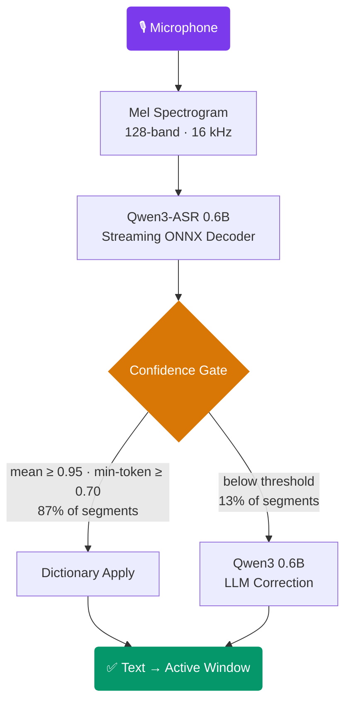

<div align="center">


# Lune Voice

**4× faster than cloud voice dictation. Fully offline. Built in Rust.**

[](LICENSE)
[](https://www.rust-lang.org)
[](#building)

*Speak → corrected text appears in your focused window. No cloud. No API keys. No telemetry.*

</div>

---

## Why Lune Voice?

Most voice tools either phone home or dump raw transcription with no cleanup. Lune gives you neither compromise:

- **280ms after-speech latency on GPU** — faster than your next breath. Cloud APIs average 600–1200ms.
- **Your voice never leaves your machine** — both models run locally via ONNX Runtime. Zero network required.
- **LLM-polished, not raw** — a 0.6B language model silently fixes filler words and grammar before text reaches you. You only ever see clean output.
- **Zero setup** — models download automatically on first launch (~1.8GB total). Bind a hotkey and go.

---

## How It Works



The confidence gate is the key insight: 87% of segments are clean enough to skip the LLM entirely, delivering at mel-spectrogram speed. Only genuinely uncertain speech pays the correction cost.

> Deep dive: [docs/ARCHITECTURE.md](docs/ARCHITECTURE.md)

---

## Quick Start

```bash
# 1. Build
cargo build --release -p lune-app

# 2. Start daemon (downloads ~1.8GB of models on first launch)
./target/release/lune-voice daemon

# 3. Bind a hotkey, then dictate
lune-voice toggle
```

---

## Building

**Prerequisites:** Rust stable (2024 edition)

```bash
# CPU-only
cargo build --release -p lune-app

# With CUDA GPU acceleration
cargo build --release -p lune-app --features cuda

# Run tests
cargo test --workspace
```

Audio capture uses `cpal` — ALSA/PipeWire on Linux, CoreAudio on macOS, WASAPI on Windows.

---

## Usage

| Subcommand | Description |
|------------|-------------|
| `daemon`   | Start the background daemon |
| `toggle`   | Start if idle, stop if active |
| `start`    | Begin dictation |
| `stop`     | End and deliver text |
| `cancel`   | Discard current session |
| `status`   | Print daemon state |
| `settings` | View or change runtime settings |
| `quit`     | Shut down daemon |

**Recommended:**
```
Ctrl+Space  →  lune-voice toggle
Escape      →  lune-voice cancel
```

---

## Configuration

```toml
[asr_backend]
type = "OrtQwenAsr"

[llm_backend]
type = "OrtLocal"

dictation_mode   = "TypeInPlace"   # TypeInPlace | Clipboard | Both
activation_mode  = "Toggle"        # Toggle | Hold
default_style    = "general"       # general | email | slack | meeting_notes | code_comments
```

Settings are mutable at runtime — no daemon restart required:

```bash
lune-voice settings style email
lune-voice settings language en-GB
lune-voice mode dictation Clipboard
```

> Full reference: [docs/CONFIGURATION.md](docs/CONFIGURATION.md)

---

## Architecture

Nine single-responsibility Rust crates connected by async message passing — audio capture, ASR, LLM, text delivery, dictionary, voice commands, persistence, and session orchestration.

> [docs/ARCHITECTURE.md](docs/ARCHITECTURE.md)

---

## Performance

|                    | GPU (RTX 4090) | CPU-only   |
|--------------------|---------------|------------|
| ASR inference      | 0.1× RT       | 0.68× RT  |
| After-speech wait  | ~280 ms       | ~885 ms   |
| LLM bypass rate    | 87%           | 87%        |
| Mel extraction     | 6,872× RT     | 6,872× RT |

Mel preprocessing consumes **<0.01%** of the inference budget. The only bottleneck is ONNX inference itself.

```bash
cargo run --example pipeline_latency -p lune-app --release
cargo run --example mel_throughput -p lune-asr --features ort-qwen --release
```

> [docs/PERFORMANCE.md](docs/PERFORMANCE.md)

---

## Contributing

1. Fork → feature branch → `cargo test --workspace`
2. Ensure `cargo fmt --all` and `cargo clippy --workspace` pass
3. Open a PR

Pre-commit hooks run `fmt`, `clippy`, and `check` automatically via [lefthook](https://github.com/evilmartians/lefthook).

---

## License

MIT — see [LICENSE](LICENSE).
